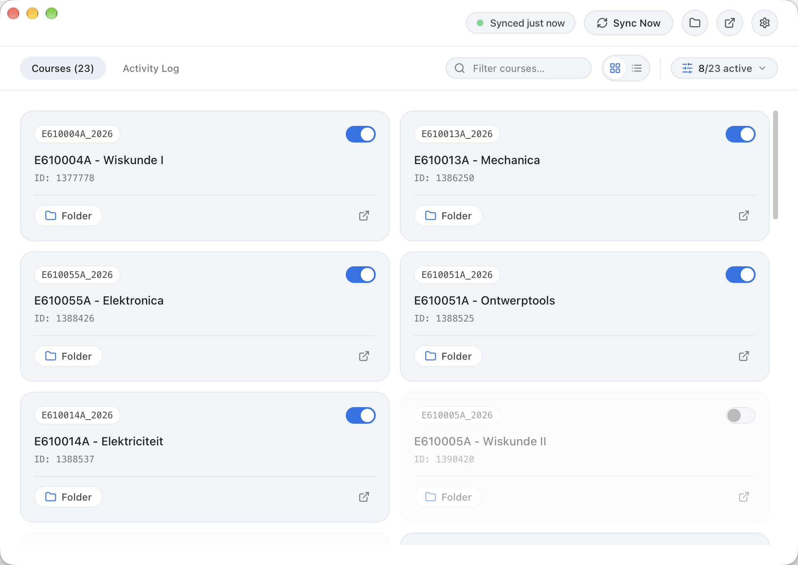

  

  
  
  
  

---

### Because clicking through 14 subfolders on Ufora every Sunday evening is nobody's hobby.

You know the drill: it’s 8:15 AM, you’re sitting in an auditorium at Campus De Sterre or Plateau, eduroam is having an existential crisis, and the prof announces: *"I uploaded the updated exercises 10 minutes ago on Ufora."*

Now you're furiously refreshing Brightspace on 4G, clicking through *Inhoud → Lesmateriaal → Werkcolleges → Week 4 → Definitief → echt_deze_v2.pdf*, waiting for a 2 MB file to download.

**Ufora Sync fixes that.** 

It runs silently in the background and automatically syncs all your course materials, slides, code, and handouts directly into a local folder on your computer (like your UGent OneDrive or local Documents).

When the professor updates a slide deck, it’s already on your laptop before you even sit down.

  

---

## 🚀 Download & Run

No command line required. Just download, open, and log in with your UGent account:

| Platform | Download Link | Notes |
| :--- | :--- | :--- |
| 🍏 **macOS** | **[Download .dmg](https://github.com/MauroDruwel/ufora-sync/releases/latest)** | Apple Silicon (M1–M4) & Intel |
| 🪟 **Windows** | **[Download .msi](https://github.com/MauroDruwel/ufora-sync/releases/latest)** | Windows 10 / 11 (x64) |
| 🐧 **Linux** | **[Download .AppImage](https://github.com/MauroDruwel/ufora-sync/releases/latest)** | Ubuntu, Fedora, Arch, Debian |

*Prefer building it yourself? See [BUILDING.md](BUILDING.md).*

---

## ✨ What makes it actually good?

- ⚡ **Lightweight & Native (Rust + Tauri v2)**  
  Built with Rust instead of a 400 MB Electron browser wrapper. It consumes less than 15 MB of RAM and 0% CPU when idle. Your laptop battery won't even notice it's running.

- ✍️ **Never overwrites your notes**  
  Took handwritten Apple Pencil notes or typed annotations onto a slide deck? Ufora Sync detects local changes and stashes them safely (`Les1_annotated.pdf`) while grabbing the latest version from the prof. Your notes never disappear.

- 🧹 **No 60-course clutter**  
  UGent Brightspace loves showing courses from 3 years ago, dead group pages, and random faculty portals. Ufora Sync automatically focuses on your **current active semester courses**, with easy toggles in Settings if you ever need an old archive.

- ☁️ **OneDrive-friendly (Files On-Demand aware)**  
  If you sync into `OneDrive - UGent` and use *"Free Up Space"*, Ufora Sync won't force OneDrive to redownload your whole disk just to check if files changed.

- 📝 **Clean folder structure**  
  Preserves the exact hierarchy your professors made (e.g. `Mechanica / Hoofdstuk 2 / Oefeningen.pdf`). No cryptic `D2L_Export_849204.zip` archives or broken file names with `%20`.

- 🔗 **Online links & quizzes as shortcuts**  
  Professor put a Wooclap link, textbook URL, or online quiz inside the content tree? It gets saved as a handy `.html` shortcut file that opens straight to the right page in your browser.

- 🎨 **Clean Google Gemini UI**  
  Looks and feels like a native macOS/Windows utility with automatic Dark/Light mode, live status dots, and zero annoying popups.

---

## 🛠 For Developers & Compiling

Want to hack on the codebase, add a feature, or build from source?  
Check out the simple guide in **[BUILDING.md](BUILDING.md)**.

---

## ⚖️ Disclaimer & License

Ufora Sync is an independent, student-built open-source project and is **not affiliated with, maintained by, or endorsed by Ghent University (UGent) or D2L (Brightspace)**. Ufora and Brightspace are trademarks of their respective owners.

Released under the **[MIT License](LICENSE)** · Built with ❤️ by **[Mauro Druwel](https://maurodruwel.be)**.
